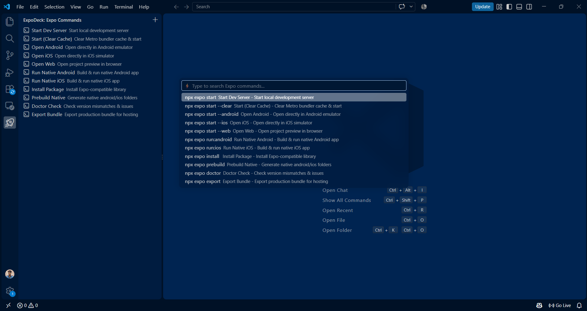
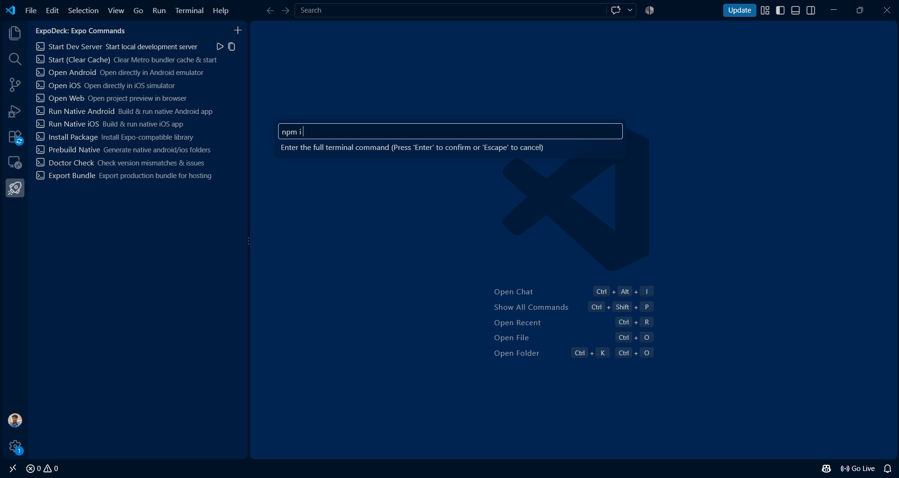
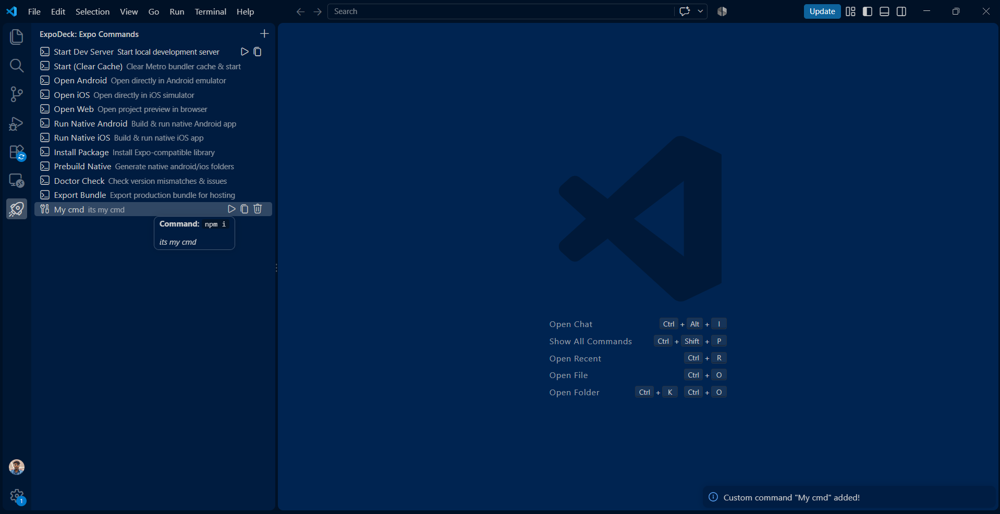

# 🚀 ExpoDeck

**ExpoDeck** is a lightweight Visual Studio Code extension designed for Expo and React Native developers. It simplifies everyday development workflows with a dedicated Sidebar Command Deck, quick command search, and convenient run and copy actions.

## 👀 Extension Preview

_ExpoDeck — Your Expo development commands, all in one place._

## ✨ Features

- 🚀 **Interactive Sidebar Command Deck** — Access essential Expo commands directly from the VS Code Activity Bar.
- ⚡ **Quick Search Menu** — Press `Ctrl + Alt + E` to find commands quickly.
- ▶️ **Run & Copy Actions** — Execute commands in a dedicated ExpoDeck terminal or copy them to the clipboard.
- 📂 **Modular Architecture** — Keep command management organized and make future expansion easier.
- 📝 **Rich Tooltips** — View command descriptions and syntax when hovering over sidebar items.

## 🛠️ Supported Commands

| Command             | Description                                | Terminal Command             |
| ------------------- | ------------------------------------------ | ---------------------------- |
| Start Dev Server    | Start the Expo development server          | `npx expo start`             |
| Start (Clear Cache) | Clear the Metro cache and start the server | `npx expo start --clear`     |
| Open Android        | Start Expo with Android                    | `npx expo start --android`   |
| Open iOS            | Start Expo with iOS                        | `npx expo start --ios`       |
| Open Web            | Start the web version                      | `npx expo start --web`       |
| Run Native Android  | Build and run the Android app              | `npx expo run:android`       |
| Run Native iOS      | Build and run the iOS app                  | `npx expo run:ios`           |
| Install Package     | Install a compatible package               | `npx expo install <package>` |
| Prebuild Native     | Generate native project directories        | `npx expo prebuild`          |
| Doctor Check        | Diagnose project configuration issues      | `npx expo doctor`            |
| Export Bundle       | Export the app for production              | `npx expo export`            |

## ⌨️ Keyboard Shortcuts

| Action            | Shortcut                                |
| ----------------- | --------------------------------------- |
| Open Quick Search | `Ctrl + Alt + E` (Windows/Linux)        |
| Open Quick Search | `Ctrl + Cmd + E` (macOS, if configured) |

_Note: The macOS shortcut works only if it is configured in the extension._

## 🌐 Marketplace

ExpoDeck is built to make common Expo development commands easier to discover and execute from within Visual Studio Code.

_Marketplace link: Add your published extension URL here once it is available._

## 👨‍💻 Author

**Jones J.**

- GitHub: [@jones2006](https://github.com/jones2006)

## 📄 License

This project is licensed under the [MIT License](LICENSE).
